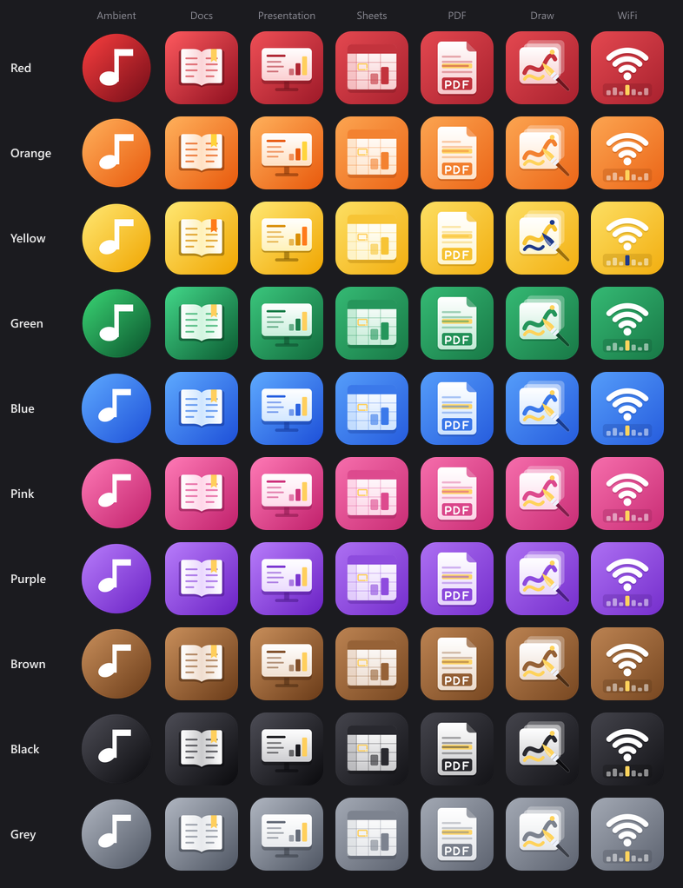

# BNC Plugins

Shared plugins for the BNC apps ([BNC Docs](https://github.com/PigeonBoi69/bnc-docs), BNC Presentation, BNC Sheets, BNC PDF and BNC Ambient):

- **App styles (`.bnctheme`)** recolor an app and change its icon. One file carries the look for **all** the BNC apps, each with its own icon.
- **Visualizers (`.bncvis`)** are animated styles for BNC Ambient only.

Everything here is MIT licensed, icons included. Plugins contain **no code** (styles are just colours and pictures); visualizers run in a sandbox inside BNC Ambient.



## App styles

| Style | File | Accent |
| --- | --- | --- |
| Red | `red.bnctheme` | `#ff4d5a` |
| Orange | `orange.bnctheme` | `#ff8a1f` |
| Yellow | `yellow.bnctheme` | `#ffd43b` |
| Green | `green.bnctheme` | `#3ddc84` |
| Blue | `blue.bnctheme` | `#3b82f6` |
| Pink | `pink.bnctheme` | `#ff5fa2` |
| Purple | `purple.bnctheme` | `#a855f7` |
| Brown | `brown.bnctheme` | `#c28a58` |
| Black | `black.bnctheme` | `#d4d4d8` |
| Grey | `grey.bnctheme` | `#9ca3af` |
| Teal | `teal.bnctheme` | `#14b8a6` |
| Cyan | `cyan.bnctheme` | `#22d3ee` |
| Indigo | `indigo.bnctheme` | `#6366f1` |
| Magenta | `magenta.bnctheme` | `#d946ef` |
| Lime | `lime.bnctheme` | `#a3e635` |
| Coral | `coral.bnctheme` | `#ff7a59` |

Each style covers `bnc-ambient`, `bnc-docs`, `bnc-presentation`, `bnc-sheets` and `bnc-pdf`.

### Install

1. Download the `.bnctheme` file (open it on GitHub and press **Download raw file**, or clone this repository).
2. In the app open **Plugins** and press **Install plugin…** (in BNC Docs: `View > App Color > Plugins…`; or just drag the file onto the window).
3. Pick it under **App Color**. The same file works in every BNC app: install it once in each.

## Visualizers

| File | What it does |
| --- | --- |
| `sparkles.bncvis` | glowing sparks float up the screen and burst on the bass |
| `dot-grid.bncvis` | a level meter made of dots |

Install them in BNC Ambient: **Settings > Plugins… > Install plugin…**.

## Make your own

The file formats are described in [docs/MAKING-PLUGINS.md](docs/MAKING-PLUGINS.md). The short version for an app style:

```
sources/<name>/
  data.json                 id, name, version, colors { accent, accentInk, swatch }, apps { "<app-id>": { "icon": "<app-id>/icon.png" } }
  bnc-ambient/icon.png      one square PNG (256-512 px) per app
  bnc-docs/icon.png
  ...
```

```bash
npm install          # once (needs Node.js 18+)
npm run pack         # sources/<name>/ -> <name>.bnctheme
npm run validate     # checks every style: valid data.json, accent colour, square PNG icons for all apps
npm run check        # also fails if a .bnctheme no longer matches its sources/ folder
```

**Adding a new BNC app's icon to every style:** add an `apps."<app-id>"` entry to each `sources/<name>/data.json`, put the icon at `sources/<name>/<app-id>/icon.png`, bump the style's `version`, run `npm run pack` and `npm run validate`, and commit both `sources/` and the rebuilt `.bnctheme` files.

Please never re-generate icons with an old script: a style's `data.json` must keep every app that already has an entry.

## Contributing

New colours and fixes are welcome: open a pull request with the `sources/<name>/` folder **and** the packed `.bnctheme`, and make sure `npm run check` passes.
Keep the icon designs consistent (rounded square for Docs, Presentation, Sheets and PDF; circle for Ambient) and use a unique `id` such as `yourname.purple-night`.

## License

MIT, see [LICENSE](LICENSE).
